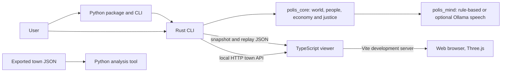

# Polis Genesis

**An autonomous town simulation where artificial life meets a living 3D world.**

[](https://eyadstein.github.io/polis-genesis/)

[](https://github.com/eyadstein/polis-genesis/actions/workflows/ci.yml)
[](https://github.com/eyadstein/polis-genesis/actions/workflows/pages.yml)
[](https://github.com/eyadstein/polis-genesis/releases)
[](https://pypi.org/project/polis-genesis/)
[](LICENSE)

## Overview

Polis Genesis models a town of autonomous residents. Each person has a genome, needs, mood, memories, relationships, and a mind that chooses actions. Residents work, trade, find homes, form families, talk, and respond to crime and the changing environment as the town evolves.

The Rust engine keeps simulation state and seeded behavior reproducible. A Python command-line package runs the tools, while a browser viewer renders exported worlds and replays in 3D. A local HTTP server can also drive the viewer with a live simulation.

## Features

- **People and behavior:** genomes, needs, moods, movement, memory, relationships, conversation, and family life.
- **Town systems:** jobs, wages, markets, housing, taxes, law enforcement, courts, and a shared treasury.
- **World simulation:** seeded runs, reports, JSON snapshots, and recorded replays.
- **Resumable Rust state:** versioned JSON saves preserve the full simulation, including its random-number generator; these are separate from viewer snapshots.
- **3D viewer:** districts, residents, homes, time controls, news, and replay playback, built with Three.js and Vite.
- **Optional local speech:** the `ollama` feature can use a local Ollama model; rule-based speech remains the default and fallback.
- **Python analysis:** a standard-library report script reads exported town JSON.

## Architecture



## Getting started

### Install the Python package

Requires Python 3.9 or newer. Install the published package with:

```bash
python -m pip install polis-genesis
```

The package provides `polis-genesis` and `polis` commands. For example, start the interactive console with the default seed, population, and duration:

```bash
polis-genesis console
```

Set the seed, population, number of ticks, or console delay with options:

```bash
polis-genesis console --seed 7 --population 120 --ticks 500 --delay 80
```

Start a local town API server (default port `8787`):

```bash
polis-genesis serve --seed 1 --population 200 --port 8787
```

Open the hosted viewer from the command line with `polis-genesis web`.

### Run from source

Install stable Rust and Cargo, Python 3.9 or newer, and Node.js with npm. From the repository root, run a simulation and print its report:

```bash
cargo run --release -p polis_cli -- 1 3000 200
```

The positional arguments are seed, ticks, and population. To write a snapshot and replay as well:

```bash
cargo run --release -p polis_cli -- 1 3000 200 town.json replay.json 10
```

Analyze the exported snapshot with the Python standard library:

```bash
python tools/analyze.py town.json
```

Town exports use format 3 and record the exact seed, initial population, map size, and market food stock over time. The viewer also reads format 2 snapshots.

Rust applications can save and resume the complete simulation state:

```rust
let save = world.save_json()?;
let resumed = polis_core::World::load_json(&save)?;
```

Simulation saves currently use format version 1. The loader rejects unsupported versions and validates restored state. Town exports and replay files remain separate formats for the viewer.

### Run the live 3D viewer locally

In one terminal at the repository root, start the simulation server:

```bash
cargo run --release -p polis_cli -- serve 1 200 8787
```

In a second terminal, install viewer dependencies and start Vite:

```bash
cd viewer
npm ci
npm run dev
```

Open the Vite URL printed in the terminal and navigate to `world.html`. The development server forwards `/api` requests to the town server on `127.0.0.1:8787`. On Windows, `./run.ps1` starts both processes and opens the viewer.

Build the static viewer from the `viewer` directory with:

```bash
npm run build
```

The output is written to `viewer/dist`. GitHub Actions builds the site and publishes it to Pages.

## Releases and project status

The latest GitHub release tag is **v0.3.0**. The Python package metadata currently declares **0.2.0**, so the package version has not caught up with the latest repository release. See the [changelog](CHANGELOG.md) for project changes and the [GitHub releases page](https://github.com/eyadstein/polis-genesis/releases) for release assets. GitHub Actions runs Rust, Python, and viewer checks and builds the Pages site.

## Documentation

- [Agent architecture and evaluation](docs/agent-architecture.md)
- [Design notes](docs/DESIGN.md)
- [Viewer performance notes](docs/viewer-performance.md)
- [Contributing guide](CONTRIBUTING.md)
- [Changelog](CHANGELOG.md)
- [MIT License](LICENSE)

## Contributing

Issues and pull requests are welcome. See [CONTRIBUTING.md](CONTRIBUTING.md) for setup, project rules, and checks used by CI.

## License

Polis Genesis is distributed under the [MIT License](LICENSE).
