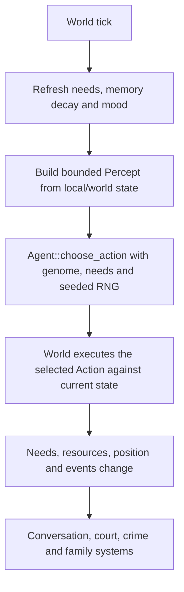

# Agent architecture and evaluation

This document describes behavior present in the Rust source today and separates it from future work. It is not a claim that residents have general intelligence.

## Current resident decision path

`World::step` processes residents in stable vector order with a seeded world RNG. A crowd map is built before per-resident actions; the decision receives a small `Percept` (nearby people, food, affordability, water, employment, and money pressure). `Agent::choose_action` scores the existing `Eat`, `Drink`, `Rest`, `Socialize`, `Work`, and `Wander` actions from need urgency, genome traits, and percepts, with seeded noise for variation. `World::live_one_tick` then executes that action and applies world rules. The viewer does not own simulation state.

The action choice is constrained by the world execution path, but there is not yet a general typed feasibility/validation interface shared by policies. Decisions are made every tick for living residents except that jailed residents are assigned `Rest` directly.

## State that exists today

| Capability | Current implementation | Limitation |
| --- | --- | --- |
| Identity | `AgentId` is a `u32`; founders and newcomers receive IDs from their position in the world vector. IDs are included in town snapshot exports. | IDs are not yet backed by a versioned, persistent full-agent save format. |
| Traits and needs | Genome, needs, mood, age, resources, job, home, family, and legal state live on each `Agent`. | Needs are not represented as explicit long-horizon goals or plans. |
| Episodic/social memory | `Mind` retains bounded memories and relationships, with fading and event refresh. | Memory is runtime state; the town snapshot exports a summary, not enough information to restore it. |
| Individual adaptation | `Brain` learns greeting and conversation choices and can inherit policy values. | This does not adapt the core survival/work action policy based on outcomes. |
| Determinism | World randomness is seeded and the tick path uses stable resident ordering; Rust tests cover repeatability. | A full save/load continuation and cross-version replay contract are not implemented. |
| Export/replay | Snapshot format 3 exports a town observation; the viewer accepts formats 2 and 3. Replay records sampled positions, actions, and speech. | These are display/export formats, not resumable simulation saves. |

## Evaluation baseline

Future behavior changes should establish a baseline before implementation and use fixed world configuration and seeds. At minimum, record:

- action feasibility and unmet-need outcomes;
- starvation, resource use, and goal completion once explicit goals exist;
- same-seed repeatability and behavior after save/load once persistence exists;
- adaptation and memory retrieval on scenarios with controlled reward, failure, and changed conditions;
- decision CPU time and memory as population and tick count grow.

Use repeated fixed-seed trials when measuring behavior distributions. Report per-run values and spread as well as averages. Do not call memory, a learned parameter, or a language-model connection an intelligence improvement without a measurable behavior change.

## Candidate projects reviewed

No external runtime framework is adopted by this repository in this change.

| Project | What it provides | Fit and cost for Polis Genesis | Decision |
| --- | --- | --- | --- |
| [Mesa](https://github.com/mesa/mesa) | Python agent-based modeling with scheduling/spatial components, visualization, and analysis. | Python >=3.12; Apache-2.0. Core dependencies include NumPy, pandas, tqdm, and SciPy; network/viz extras add NetworkX and a web visualization stack. Active project; Mesa 3 stable while Mesa 4 is in active development and metadata labels the package alpha. The Python runtime and scientific stack are extra deployment and maintenance cost for a Rust engine. | Replacing the current engine would duplicate scheduling/spatial behavior and move the hot loop out of Rust. May be useful for a separate analysis/reference model if a concrete experiment needs it; do not adopt in the simulation runtime. |
| [PettingZoo](https://github.com/Farama-Foundation/PettingZoo) | Python APIs and tests for multi-agent reinforcement-learning environments, with AEC and simultaneous-action Parallel APIs. | Python; MIT. Core dependencies include NumPy, Gymnasium, and typing-extensions; game-family extras add libraries such as pygame-ce and physics packages. Active project; release 1.27.0 is available. Training frameworks are separate. Python adapter serialization/translation and dependency maintenance would be needed. | Could be an isolated adapter for external policy evaluation, but no current training loop or environment boundary exists. Do not embed it in the Rust tick loop; defer until an experiment requires an adapter. |
| [Gymnasium](https://github.com/Farama-Foundation/Gymnasium) | Standard Python single-agent RL environment API and reference utilities. | Python >=3.10; MIT. Core dependencies include NumPy, cloudpickle, typing-extensions, and farama-notifications; optional environment and learning extras add larger packages. Active project with production/stable package metadata. This remains an offline harness cost, not a runtime cost, if isolated. | Relevant only to an offline evaluation harness, not resident runtime. It does not solve current persistence or decision semantics. Defer pending an evaluated learning policy and measurable benefit. |
| [krABMaga](https://github.com/krABMaga/krABMaga) | Rust discrete-event ABM engine with spatial components, parallelism, visualization, and model-exploration features. | Rust; MIT per package metadata. Core dependencies include `rand`, `rayon`, `hashbrown`, and a priority queue; visualization, AWS, and MPI add substantial optional dependency sets. The published package metadata is 0.5.3; the official commit history available during review showed latest activity in December 2025, so current maintenance cadence is uncertain. No comparable Polis workload benchmark was found. | Rust is a language fit, but replacing Polis's working engine would duplicate its world/economy/simulation model and add substantial dependencies. Do not adopt; consider its scheduler and parallelism concepts only if profiling identifies a matching need. |
| [Ponytail](https://github.com/DietrichGebert/ponytail) | Agent engineering guidance and optional coding-agent tooling. | MIT; current repository includes `AGENTS.md` and optional agent-specific skills. No runtime dependency or deployment cost is needed to apply its engineering guidance. | Translate the code-understanding, small-change, and validation principles into root `AGENTS.md`; do not install tooling or copy code. |

Candidate licenses, package metadata/dependencies, and release activity were checked against official repositories on 2026-10-22. The performance and memory cost of running these frameworks against Polis Genesis has not been measured because no adapter exists. Recheck maintenance and license details before a later dependency adoption.

## Staged work

The repository already has stable IDs, per-resident needs, a seeded action policy, and bounded social memory. Those existing parts should be extended rather than duplicated.

1. **Foundations:** define explicit goals/intentions, validated action boundaries, and a versioned resumable state format; test identity and deterministic continuation.
2. **Memory:** persist selected bounded episodic/semantic/social state and prove retrieval can change a decision in a controlled scenario.
3. **Adaptation:** establish deterministic policy baselines, then evaluate individual preference updates on fixed scenarios.
4. **Social behavior:** measure cooperation, conflict, and resource outcomes through local interactions.
5. **Scale:** profile decision cost before adding staged scheduling, batching, or optional specialized models.
6. **Viewer:** expose selected agent state only after the data contract is stable, without making rendering authoritative.

Each stage should be a focused pull request with observable acceptance criteria, compatibility notes, tests, and a reproducible evaluation. The order can change when source dependencies require it; document the reason.
